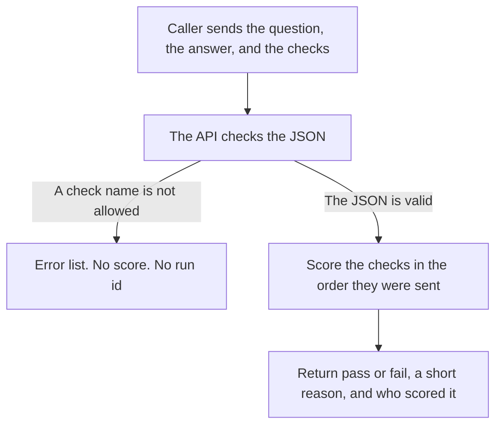

# Prompt evaluation: four real runs

This note follows one question and one answer from the API request to the API response. The same pair was scored three ways: DeepEval, Ragas, and FreeEval. A fourth request asked for a check the service does not offer, and the service rejected it.

The runs were made on 14 November 2026 through `POST /apis/endpoints/prompts/evaluations`, the prompt route on the FreeEval application (`create_app` in `src/freeeval/api/app.py`). DeepEval and Ragas used the judge model `gpt-4o-mini` (`FREEEVAL_DEEPEVAL_MODEL`). An OpenAI key was present in the environment. The key is not shown here.

Read the request, the response, and **What this means** in each scenario. The step list under that is the file and method the request passed through.

## The outcome in one look

The question was **What is the capital of France?** The answer was **Paris is the capital of France.** Each successful request asked for two checks, both with a pass line of **0.5** (half of a perfect score of 1):

| Check | Plain question |
| --- | --- |
| `answer_relevancy` | Does the answer address the question? |
| `conciseness` | Is the answer about as short as the question, or shorter? |

A check **passes** when its score is greater than or equal to its own pass line. A later call gets a new `run_id`. The service does not save the run.

| Scenario | Who scored "does the answer address the question?" | HTTP | Result | Time |
| --- | --- | --- | --- | --- |
| DeepEval | DeepEval, by asking the OpenAI judge | 200 | Both checks passed | 6.8 seconds |
| Ragas | Ragas, by asking the OpenAI judge and comparing embeddings | 200 | Both checks passed | 14.4 seconds |
| FreeEval | FreeEval, by counting overlapping words on this machine | 200 | Both checks passed | under 0.01 seconds |
| Error | Nobody. The check name `bleu` is not one of the three prompt checks | 422 | Request rejected | under 0.01 seconds |

`conciseness` is always counted by FreeEval. DeepEval and Ragas are asked to score `answer_relevancy` only. The response field `framework` is what the caller asked for. The field `implementation` on each check is who actually scored that line.

## How every call enters the service

At startup, `create_app` in `src/freeeval/api/app.py` mounts the prompts router at `/apis/endpoints`. The router in `src/freeeval/api/routers/prompts.py` adds `/prompts`. The method `evaluate_prompts` handles `POST /evaluations`. Together that is:

`POST /apis/endpoints/prompts/evaluations`



## Scenario 1 — DeepEval

The caller asks DeepEval to judge the answer. DeepEval scores answer relevancy by calling OpenAI. Conciseness stays with FreeEval, because that check is outside the DeepEval prompt set.

### Request

```http
POST /apis/endpoints/prompts/evaluations
Content-Type: application/json
```

```json
{
  "prompt": "What is the capital of France?",
  "answer": "Paris is the capital of France.",
  "metrics": [
    {"name": "answer_relevancy", "threshold": 0.5},
    {"name": "conciseness", "threshold": 0.5}
  ],
  "framework": "deepeval"
}
```

### Response

HTTP **200**. Time: **6.8 seconds**.

```json
{
  "run_id": "537cd13c6b4a466bb66924cee1635944",
  "framework": "deepeval",
  "metrics": [
    {
      "name": "answer_relevancy",
      "result": "pass",
      "reasoning": "DeepEval AnswerRelevancyMetric: The score is 1.00 because the response directly answered the question about the capital of France without any irrelevant statements.",
      "implementation": "deepeval"
    },
    {
      "name": "conciseness",
      "result": "pass",
      "reasoning": "FreeEval conciseness: The answer has 6 words and the prompt has 6 words.",
      "implementation": "freeeval"
    }
  ]
}
```

### What this means

The judge gave answer relevancy a perfect score of 1.00, which is above the pass line of 0.5, so that check passed. DeepEval did that work. The answer and the question are the same length (6 words each), so conciseness also scored 1.00 and passed. FreeEval did that work. The caller asked for DeepEval, and the response says so in `framework`. Each line names the scorer that actually ran.

### Step by step

**1. Match the URL.**
`src/freeeval/api/app.py` — `create_app` has mounted the router at `/apis/endpoints`.
`src/freeeval/api/routers/prompts.py` — the router prefix `/prompts` plus `POST /evaluations` selects `evaluate_prompts`.

**2. Check the JSON before any scoring.**
`src/freeeval/api/schemas.py` — `PromptEvaluationRequest` requires a non-empty `prompt`, a non-empty `answer`, a non-empty `metrics` list, and a `framework` of `freeeval`, `deepeval`, or `ragas`.
`src/freeeval/api/schemas.py` — `PromptMetricSpec` requires each `name` to be `answer_relevancy`, `conciseness`, or `specificity`, and each `threshold` to be from 0 to 1.
`src/freeeval/api/schemas.py` — `PromptEvaluationRequest.reject_duplicate_metrics` requires the names in this request to be unique.

**3. Start the evaluation.**
`src/freeeval/api/routers/prompts.py` — `evaluate_prompts` calls `score_prompt` with the framework, the prompt, the answer, and the metric list.

**4. Walk the checks in request order.**
`src/freeeval/evaluation/dispatch.py` — `score_prompt` calls `_name` and `_threshold` for a metric, then `_score_metric`.

**5. Send answer relevancy to DeepEval.**
`src/freeeval/evaluation/dispatch.py` — `_score_metric` sees that `deepeval` supports `answer_relevancy` (`_PROMPT_SUPPORTED`) and calls the judge function.
`src/freeeval/evaluation/dispatch.py` — `_prompt_judge` sees `framework == "deepeval"` and calls `_deepeval().score_answer_relevancy(question, answer, threshold)`.
`src/freeeval/evaluation/dispatch.py` — `_deepeval` imports and calls `get_deepeval_evaluator`.
`src/freeeval/evaluation/factory.py` — `get_deepeval_evaluator` calls `_judge_settings`.
`src/freeeval/evaluation/factory.py` — `_judge_settings` builds `Settings`.
`src/freeeval/config.py` — `Settings` reads `FREEEVAL_DEEPEVAL_MODEL` (`gpt-4o-mini`) and `OPENAI_API_KEY`.
`src/freeeval/evaluation/deepeval.py` — `DeepEvalEvaluator.__init__` stores the model name and the key.
`src/freeeval/evaluation/deepeval.py` — `score_answer_relevancy` calls `_load_sdk`, which imports DeepEval's `AnswerRelevancyMetric`, `OpenAIModel`, and `LLMTestCase`.
`src/freeeval/evaluation/deepeval.py` — `_create_model` builds DeepEval's `OpenAIModel` at temperature 0.
`src/freeeval/evaluation/deepeval.py` — `score_answer_relevancy` builds an `LLMTestCase` with the question as input and the answer as output.
`src/freeeval/evaluation/deepeval.py` — `_create_metric` builds `AnswerRelevancyMetric` with the pass line, the model, a written reason, and synchronous mode.
`src/freeeval/evaluation/deepeval.py` — `_measure` calls `metric.measure`. That is the OpenAI call. It reads the score `1.00` and the reason, and returns `MetricEvaluation`.

**6. Turn the judge score into pass or fail.**
`src/freeeval/evaluation/dispatch.py` — `_score_metric` compares `1.00` with the pass line `0.5`. The score is high enough, so `result` is `pass`. It prefixes the reason with `DeepEval AnswerRelevancyMetric` (from `_LABELS`) and sets `implementation` to `deepeval`. The value is a `ScoredMetric`.

**7. Score conciseness on this machine.**
`src/freeeval/evaluation/dispatch.py` — `_score_metric` sees that `conciseness` is outside the DeepEval prompt set, so it calls the FreeEval function.
`src/freeeval/metrics/prompt/evaluation.py` — `build_prompt_metric("conciseness", 0.5)` looks up `PROMPT_METRIC_TYPES` and constructs `Conciseness`.
`src/freeeval/metrics/prompt/conciseness.py` — `Conciseness.__init__` calls `RootMetric.__init__`.
`src/freeeval/metrics/base.py` — `RootMetric.__init__` stores the name and confirms the pass line is from 0 to 1.
`src/freeeval/metrics/prompt/evaluation.py` — `PromptEvaluation.__init__` holds that one metric, then `PromptEvaluation.evaluate` calls `Conciseness.evaluate`.
`src/freeeval/metrics/prompt/conciseness.py` — `Conciseness.evaluate` counts words in the question and the answer.
`src/freeeval/metrics/prompt/text.py` — `tokens` and `word_count_label` forward to the shared helpers.
`src/freeeval/metrics/text.py` — `tokens` lowercases the text and keeps letters and digits. Both sides have 6 words: `what is the capital of france` and `paris is the capital of france`. The score is `min(1, 6/6) = 1.0`. `word_count_label` supplies the word "words" in the reason.
`src/freeeval/metrics/prompt/evaluation.py` — `PromptEvaluation.evaluate` marks `pass` because `1.0` is at least `0.5`, and returns a `MetricVerdict`.
`src/freeeval/evaluation/dispatch.py` — `_one` reads that verdict. `_score_metric` adds the prefix `FreeEval conciseness:` because the caller asked for another framework, and sets `implementation` to `freeeval`.

**8. Build the HTTP response.**
`src/freeeval/api/routers/prompts.py` — `evaluate_prompts` builds `PromptEvaluationResponse` with `run_id` from `uuid4().hex`, `framework` `deepeval`, and one `PromptMetricResult` per scored line, in request order.
`src/freeeval/api/schemas.py` — `PromptEvaluationResponse` and `PromptMetricResult` are the response shape. FastAPI serializes them and returns HTTP 200.

## Scenario 2 — Ragas

The caller asks Ragas to judge the answer. Ragas scores answer relevancy with an OpenAI chat model and an OpenAI embedding model. Conciseness again stays with FreeEval.

### Request

```http
POST /apis/endpoints/prompts/evaluations
Content-Type: application/json
```

```json
{
  "prompt": "What is the capital of France?",
  "answer": "Paris is the capital of France.",
  "metrics": [
    {"name": "answer_relevancy", "threshold": 0.5},
    {"name": "conciseness", "threshold": 0.5}
  ],
  "framework": "ragas"
}
```

### Response

HTTP **200**. Time: **14.4 seconds**.

```json
{
  "run_id": "dbc85b23dfb24f6099b5279979e53885",
  "framework": "ragas",
  "metrics": [
    {
      "name": "answer_relevancy",
      "result": "pass",
      "reasoning": "Ragas AnswerRelevancy: score 1.00",
      "implementation": "ragas"
    },
    {
      "name": "conciseness",
      "result": "pass",
      "reasoning": "FreeEval conciseness: The answer has 6 words and the prompt has 6 words.",
      "implementation": "freeeval"
    }
  ]
}
```

### What this means

Ragas gave answer relevancy a score of 1.00. That is above 0.5, so the check passed. The reason line is the score itself, which is what Ragas returned for this run. Conciseness passed on the same 6-word to 6-word comparison as in the DeepEval run, scored by FreeEval. This call took longer because Ragas also builds an embedding of the text.

### Step by step

**1. Match the URL.**
`src/freeeval/api/app.py` — `create_app` serves the route under `/apis/endpoints`.
`src/freeeval/api/routers/prompts.py` — `evaluate_prompts` is selected for `POST /prompts/evaluations`.

**2. Check the JSON before any scoring.**
`src/freeeval/api/schemas.py` — `PromptEvaluationRequest` accepts `framework` `ragas` and the two text fields.
`src/freeeval/api/schemas.py` — `PromptMetricSpec` accepts both metric names and both pass lines.
`src/freeeval/api/schemas.py` — `PromptEvaluationRequest.reject_duplicate_metrics` accepts the two different names.

**3. Start the evaluation.**
`src/freeeval/api/routers/prompts.py` — `evaluate_prompts` calls `score_prompt`.

**4. Walk the checks in request order.**
`src/freeeval/evaluation/dispatch.py` — `score_prompt` calls `_name`, `_threshold`, and `_score_metric` for `answer_relevancy`.

**5. Send answer relevancy to Ragas.**
`src/freeeval/evaluation/dispatch.py` — `_score_metric` sees that `ragas` supports `answer_relevancy` and calls the judge function.
`src/freeeval/evaluation/dispatch.py` — `_prompt_judge` takes the Ragas branch and calls `_ragas().score_answer_relevancy(question, answer, threshold)`.
`src/freeeval/evaluation/dispatch.py` — `_ragas` imports and calls `get_ragas_evaluator`.
`src/freeeval/evaluation/factory.py` — `get_ragas_evaluator` calls `_judge_settings`, which builds `Settings`.
`src/freeeval/config.py` — `Settings` reads `gpt-4o-mini` and the OpenAI key.
`src/freeeval/evaluation/ragas.py` — `RagasEvaluator.__init__` stores the model name and the key.
`src/freeeval/evaluation/ragas.py` — `score_answer_relevancy` calls `_load_sdk`.
`src/freeeval/evaluation/ragas.py` — `_load_sdk` calls `_allow_ragas_vertex_import` so the Ragas package can import, then loads `AnswerRelevancy`, `llm_factory`, `embedding_factory`, and `AsyncOpenAI`.
`src/freeeval/evaluation/ragas.py` — `_llm` builds an `AsyncOpenAI` client and Ragas `llm_factory` for `gpt-4o-mini` at temperature 0.
`src/freeeval/evaluation/ragas.py` — `_embeddings` builds an `AsyncOpenAI` client and Ragas `embedding_factory` for `text-embedding-3-small`.
`src/freeeval/evaluation/ragas.py` — `score_answer_relevancy` builds Ragas `AnswerRelevancy` with that chat model and those embeddings.
`src/freeeval/evaluation/ragas.py` — `_call` runs `AnswerRelevancy.score` with the question (`user_input`) and the answer (`response`). That is the OpenAI call.
`src/freeeval/evaluation/ragas.py` — `_value` reads the numeric score `1.00`. The score is already inside 0 to 1, so it stays `1.00`.
`src/freeeval/evaluation/ragas.py` — `_reason` finds no separate written reason, so the service uses `score 1.00`. The method returns `MetricEvaluation`.

**6. Turn the judge score into pass or fail.**
`src/freeeval/evaluation/dispatch.py` — `_score_metric` compares `1.00` with `0.5`, sets `result` to `pass`, prefixes the reason with `Ragas AnswerRelevancy`, and sets `implementation` to `ragas`.

**7. Score conciseness on this machine.**
The calls are the same as DeepEval step 7:
`src/freeeval/evaluation/dispatch.py` — `_score_metric` calls the FreeEval function because `conciseness` is outside the Ragas prompt set.
`src/freeeval/metrics/prompt/evaluation.py` — `build_prompt_metric`, then `PromptEvaluation.evaluate`.
`src/freeeval/metrics/prompt/conciseness.py` — `Conciseness.evaluate`.
`src/freeeval/metrics/base.py` — `RootMetric.__init__`.
`src/freeeval/metrics/prompt/text.py` and `src/freeeval/metrics/text.py` — `tokens` and `word_count_label`.
Score `1.0`, result `pass`. `_one` returns the verdict. `_score_metric` prefixes `FreeEval conciseness:` and sets `implementation` to `freeeval`.

**8. Build the HTTP response.**
`src/freeeval/api/routers/prompts.py` — `evaluate_prompts` builds `PromptEvaluationResponse` with a new `run_id` (`uuid4().hex`) and `framework` `ragas`.
`src/freeeval/api/schemas.py` — `PromptMetricResult` carries each line. FastAPI returns HTTP 200.

## Scenario 3 — FreeEval

The caller asks FreeEval to score both checks on this machine. There is no call to OpenAI. Answer relevancy is the share of meaningful question words that also appear in the answer. Conciseness is the question length divided by the answer length, capped at 1.

### Request

```http
POST /apis/endpoints/prompts/evaluations
Content-Type: application/json
```

```json
{
  "prompt": "What is the capital of France?",
  "answer": "Paris is the capital of France.",
  "metrics": [
    {"name": "answer_relevancy", "threshold": 0.5},
    {"name": "conciseness", "threshold": 0.5}
  ],
  "framework": "freeeval"
}
```

Leaving `framework` out has the same effect. The default is `freeeval`.

### Response

HTTP **200**. Time: **under 0.01 seconds**.

```json
{
  "run_id": "3f52ee99b38742c3820894268f59e590",
  "framework": "freeeval",
  "metrics": [
    {
      "name": "answer_relevancy",
      "result": "pass",
      "reasoning": "2 of 2 prompt content words appear in the answer.",
      "implementation": "freeeval"
    },
    {
      "name": "conciseness",
      "result": "pass",
      "reasoning": "The answer has 6 words and the prompt has 6 words.",
      "implementation": "freeeval"
    }
  ]
}
```

### What this means

The meaningful words in the question are `capital` and `france`. Everyday words such as `what`, `is`, `the`, and `of` are set aside. Both meaningful words appear in the answer, so the score is 2/2 = 1.00 and the check passes. The answer is the same length as the question, so conciseness is 6/6 = 1.00 and also passes. Both lines were scored by FreeEval, which matches what the caller asked for.

### Step by step

**1. Match the URL.**
`src/freeeval/api/app.py` — `create_app` serves `/apis/endpoints`.
`src/freeeval/api/routers/prompts.py` — `evaluate_prompts` handles the post.

**2. Check the JSON before any scoring.**
`src/freeeval/api/schemas.py` — `PromptEvaluationRequest` accepts `framework` `freeeval`.
`src/freeeval/api/schemas.py` — `PromptMetricSpec` accepts both metrics.
`src/freeeval/api/schemas.py` — `PromptEvaluationRequest.reject_duplicate_metrics` accepts the two names.

**3. Start the evaluation.**
`src/freeeval/api/routers/prompts.py` — `evaluate_prompts` calls `score_prompt`.

**4. Score answer relevancy on this machine.**
`src/freeeval/evaluation/dispatch.py` — `score_prompt` calls `_name`, `_threshold`, and `_score_metric`.
`src/freeeval/evaluation/dispatch.py` — `_score_metric` sees that `freeeval` is the local scorer (`_PROMPT_SUPPORTED` lists only `deepeval` and `ragas`), so it calls the FreeEval function.
`src/freeeval/metrics/prompt/evaluation.py` — `build_prompt_metric("answer_relevancy", 0.5)` constructs `AnswerRelevancy`.
`src/freeeval/metrics/prompt/answer_relevancy.py` — `AnswerRelevancy.__init__` calls `RootMetric.__init__`.
`src/freeeval/metrics/base.py` — `RootMetric.__init__` stores the name and the pass line.
`src/freeeval/metrics/prompt/evaluation.py` — `PromptEvaluation.evaluate` calls `AnswerRelevancy.evaluate`.
`src/freeeval/metrics/prompt/answer_relevancy.py` — `evaluate` takes the meaningful words of the question and of the answer.
`src/freeeval/metrics/prompt/text.py` — `content_tokens` forwards to the shared helper.
`src/freeeval/metrics/text.py` — `content_tokens` calls `tokens`, then drops stopwords. The question keeps `capital` and `france`. Both are in the answer. The score is `1.0`. The reason is `2 of 2 prompt content words appear in the answer.`
`src/freeeval/metrics/prompt/evaluation.py` — `PromptEvaluation.evaluate` sets `result` to `pass` because `1.0 >= 0.5`.
`src/freeeval/evaluation/dispatch.py` — `_one` reads the verdict. `_score_metric` keeps the reason as written, because the caller asked for FreeEval, and sets `implementation` to `freeeval`.

**5. Score conciseness on this machine.**
`src/freeeval/evaluation/dispatch.py` — `score_prompt` calls `_score_metric` for the second metric, which again uses the FreeEval function.
`src/freeeval/metrics/prompt/evaluation.py` — `build_prompt_metric("conciseness", 0.5)` and `PromptEvaluation.evaluate`.
`src/freeeval/metrics/prompt/conciseness.py` — `Conciseness.evaluate` via `RootMetric.__init__` in `src/freeeval/metrics/base.py`.
`src/freeeval/metrics/prompt/text.py` and `src/freeeval/metrics/text.py` — `tokens` and `word_count_label`.
The score is `1.0`. The reason is `The answer has 6 words and the prompt has 6 words.` There is no extra prefix. `implementation` is `freeeval`.

**6. Build the HTTP response.**
`src/freeeval/api/routers/prompts.py` — `evaluate_prompts` builds `PromptEvaluationResponse` with a new `run_id` and `framework` `freeeval`.
`src/freeeval/api/schemas.py` — `PromptMetricResult` carries each line. FastAPI returns HTTP 200.

## Scenario 4 — Error

The caller asks for a check named `bleu`. The prompt route offers only `answer_relevancy`, `conciseness`, and `specificity`. The service rejects the JSON at the door. Scoring never starts, and the response has no `run_id`.

### Request

```http
POST /apis/endpoints/prompts/evaluations
Content-Type: application/json
```

```json
{
  "prompt": "What is the capital of France?",
  "answer": "Paris is the capital of France.",
  "metrics": [
    {"name": "bleu", "threshold": 0.5}
  ],
  "framework": "freeeval"
}
```

### Response

HTTP **422**. Time: **under 0.01 seconds**. The body is a list, one item per problem.

```json
[
  {
    "error_code": "VALIDATION_ERROR",
    "reason_code": "UNSUPPORTED_METRIC",
    "message": "metrics.0.name: Input should be 'answer_relevancy', 'conciseness' or 'specificity'"
  }
]
```

### What this means

The request never became a scored run. `error_code` says this is a validation problem. `reason_code` says the metric name is not supported. `message` names the field (`metrics.0.name` is the name of the first check) and lists the three names the route accepts. The caller can correct the name and send the request again.

### Step by step

**1. Match the URL.**
`src/freeeval/api/app.py` — `create_app` serves `/apis/endpoints` and has registered `list_validation_handler` for invalid JSON bodies.
`src/freeeval/api/routers/prompts.py` — FastAPI selects `evaluate_prompts` and tries to build its `body` argument. The method itself is not entered.

**2. Reject the check name.**
`src/freeeval/api/schemas.py` — `PromptMetricSpec` only allows `name` to be `answer_relevancy`, `conciseness`, or `specificity`. The value `bleu` fails that check. FastAPI raises `RequestValidationError`.
`PromptEvaluationRequest.reject_duplicate_metrics` is not reached. `score_prompt` is not called. DeepEval, Ragas, and the local metric classes are not called.

**3. Turn the validation failure into the public error list.**
`src/freeeval/api/app.py` — `list_validation_handler` sees that the path is `/apis/endpoints/prompts/evaluations` (one of `LIST_ERROR_PATHS`) and calls `validation_errors`.
`src/freeeval/api/errors.py` — `validation_errors` reads the FastAPI error.
`src/freeeval/api/errors.py` — `_field` turns the error location into `metrics.0.name`.
`src/freeeval/api/errors.py` — `_reason_code` sees a `literal_error` on a `metrics` field and returns `UNSUPPORTED_METRIC`.
`src/freeeval/api/schemas.py` — `APIError` holds `error_code` `VALIDATION_ERROR`, that reason code, and the message `metrics.0.name: Input should be 'answer_relevancy', 'conciseness' or 'specificity'`.

**4. Return the list.**
`src/freeeval/api/app.py` — `list_validation_handler` returns a `JSONResponse` with status 422 and a one-item list. There is no `run_id`.

## Words used in the response

| Word | Meaning |
| --- | --- |
| `run_id` | A new id for this successful response. It changes on every call. |
| `framework` | The scorer the caller asked for: `freeeval`, `deepeval`, or `ragas`. |
| `implementation` | The scorer that actually produced that line. |
| `result` | `pass` when the score is at least that check's `threshold`. `fail` when it is lower. |
| `reasoning` | A short explanation of the score. |
| `threshold` | The pass line for one check, from 0 to 1. Each check has its own. |
| `error_code` | The kind of failure. Validation uses `VALIDATION_ERROR`. |
| `reason_code` | The specific cause. An unknown check name uses `UNSUPPORTED_METRIC`. |

Other validation failures use the same list shape and the same files (`list_validation_handler` → `validation_errors` → `APIError`). A missing field uses `MISSING_FIELD`. An empty prompt or an empty metric list uses `EMPTY`. A repeated metric name uses `DUPLICATE_METRIC`. A pass line outside 0 to 1 uses `OUT_OF_RANGE`. An unexpected field uses `UNKNOWN_FIELD`.
